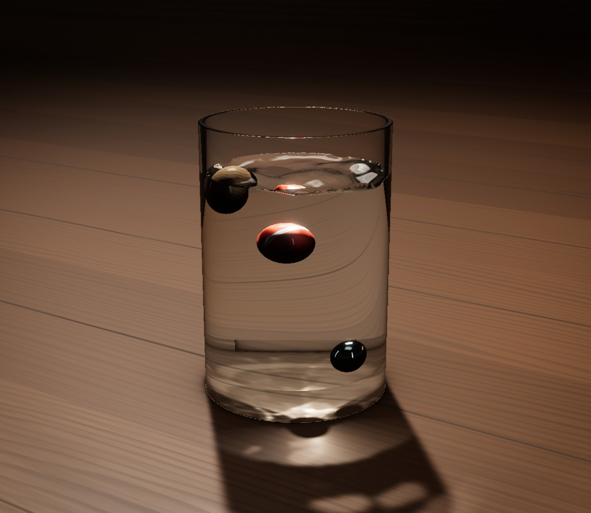
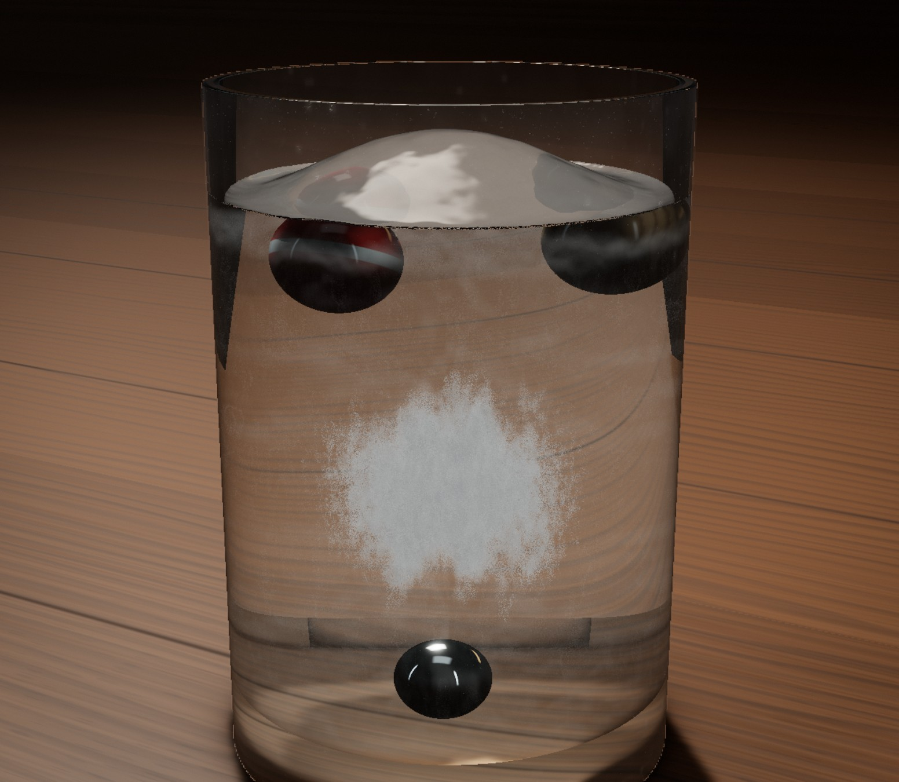
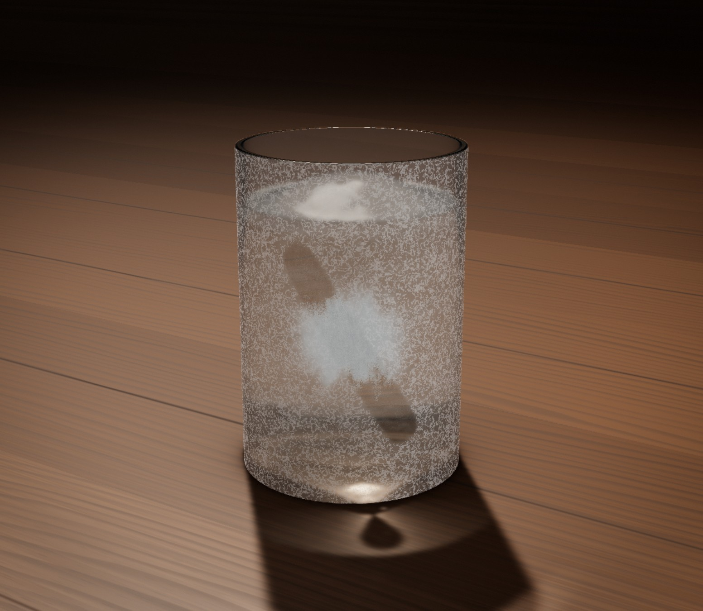
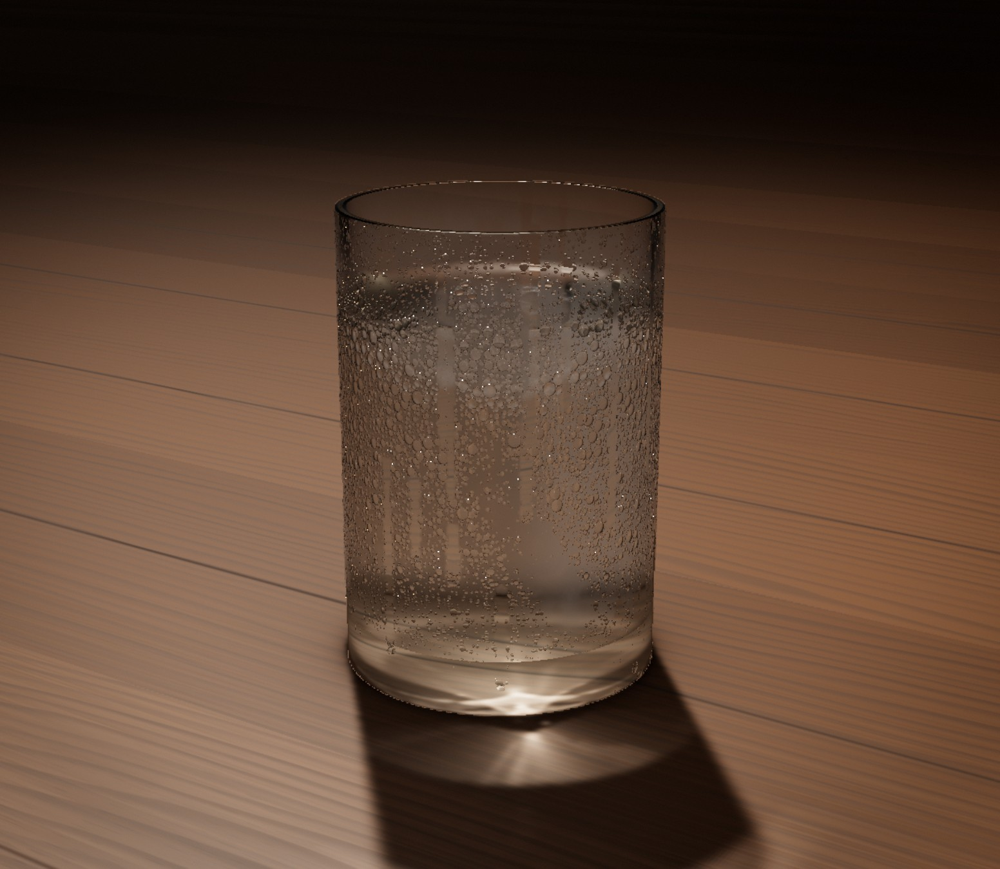
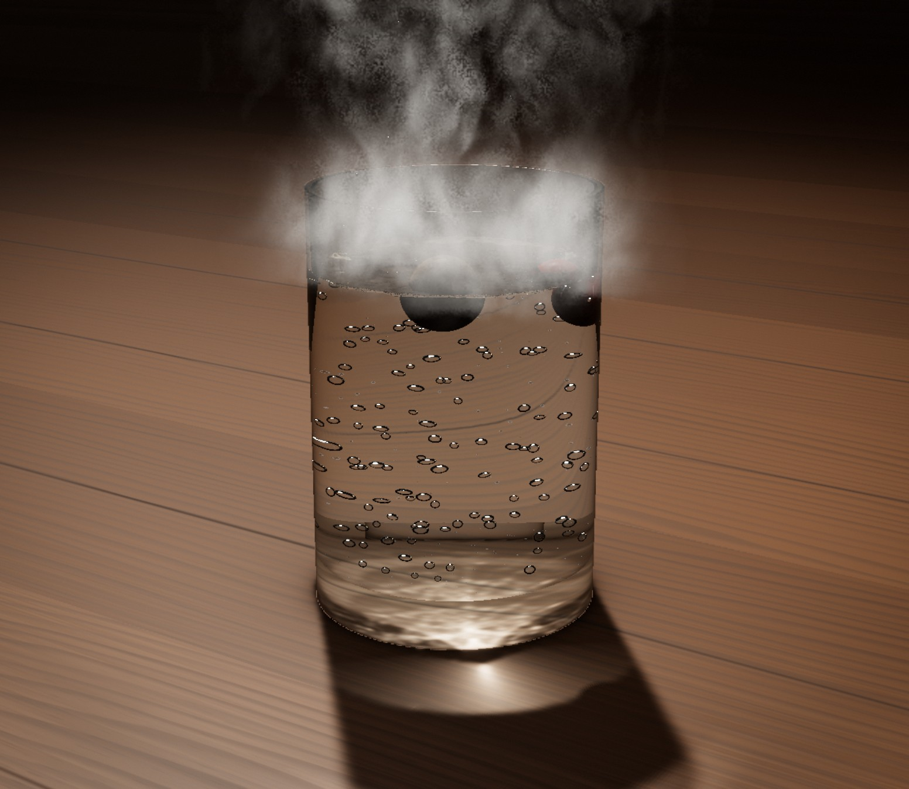
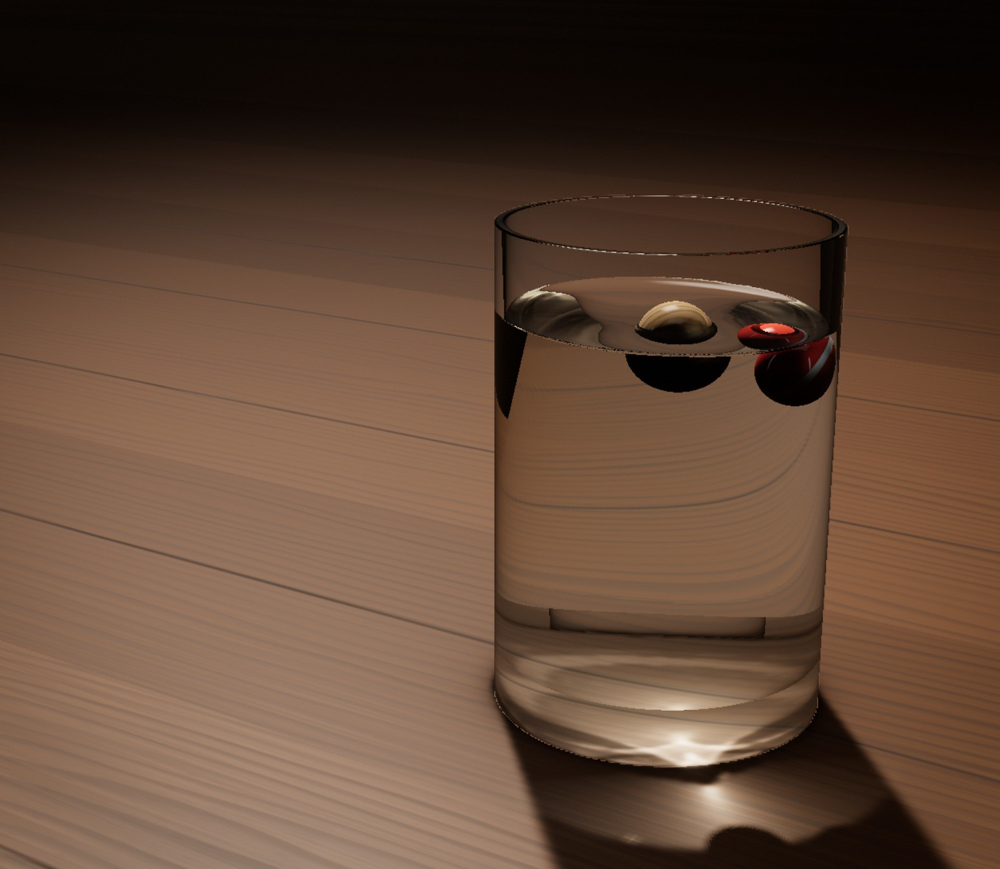
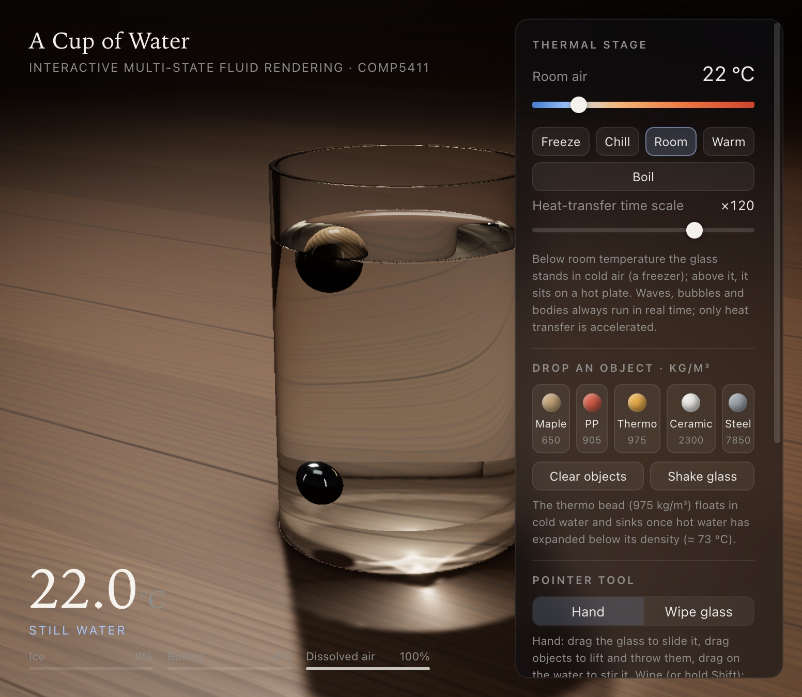

# A Cup of Water — Interactive Multi-State Fluid Rendering

COMP5411 Advanced Computer Graphics · course project

A glass of water on a walnut table, rendered in real time in WebGL 2. One thermal control —
the temperature of the air around the glass, or of a hot plate underneath it — drives every
physical process: the water freezes from the rim inward and traps floating objects in an ice lid,
the glass frosts over and can be wiped clean, the frost melts into running droplets when the glass
warms up, and heating produces dissolved-air bubbles, then vapour bubbles that collapse in
sub-cooled water and finally a rolling boil with steam. At every temperature the glass can be
dragged and shaken, the water stirred, and objects of five different densities dropped in.

The goal was not a collection of effects but one **coupled simulation**: every visible effect is
the output of a physical model with measured material properties, and the models feed each
other (temperature → density, viscosity, surface tension → wave speed and damping, bubble
departure size, rise velocity → bursts → ripples → floating bodies; temperature → ice → rigid
surface, trapped objects, cloudy ice; glass temperature → dew point → fog / frost → droplets).

| | |
|---|---|
|  |  |
| Ripples, floating maple and PP balls, sunken steel ball, caustics on the table | Frozen solid: clear shell, cloudy core of trapped air, expansion dome; floating balls locked in the lid, steel engulfed on the bottom |
|  |  |
| Hoar frost on the glass after freezing, partly wiped off with the mouse | Back at room air: the frost melts into droplets and drips, the glass fogs |
|  |  |
| Rolling boil on the hot plate: irregular, growing bubbles, bursts, steam, jiggling floating balls | Sloshing after the glass is dragged |



---

## Running

Requires Node.js ≥ 18 and a browser with WebGL 2 and `EXT_color_buffer_float`
(any recent Chrome, Edge, Firefox or Safari).

```bash
npm install
npm run dev          # http://localhost:5411
```

Production build (static files in `dist/`, can be served from any directory):

```bash
npm run build
npm run preview      # http://localhost:5412
```

### Controls

| Input | Action |
|---|---|
| Drag the glass | slide it across the table (the water sloshes, objects lag behind) |
| Drag on the water | stir the surface |
| Drag an object | lift it out and throw it |
| Drag empty space / wheel | orbit / zoom the camera |
| Shift + drag, or the *Wipe* tool | wipe fog and frost off the glass |
| `1`–`5` | drop maple (650 kg/m³), PP plastic (905), thermo bead (975), ceramic (2300), steel (7850) |
| `F` / `R` / `B` | freezer −25 °C / room 22 °C / hot plate 230 °C |
| `S` | shake the glass |
| `W` | toggle wipe tool |
| `C` | clear objects |
| `P` or space | pause |
| `H` | hide the UI |
| `D` | cycle debug insets |

The panel exposes the thermal stage (slider and presets *Freeze −25*, *Chill 2*, *Room 22*,
*Warm 85*, *Boil 230*), the **heat-transfer time scale** (×1 … ×600, default ×120; waves,
bubbles and bodies always run in real time — only heat conduction is accelerated, otherwise
freezing a glass would take hours), object buttons (Shift+click drops three), *Fresh water* and
*Boiled water* (degassed: no air bubbles on heating), and two collapsible sections:

* **Physical coupling** — switch off sloshing, body↔wave, ice↔waves/bodies, bubble→surface,
  bubble→body coupling and bubble nucleation to compare against uncoupled baselines.
* **Rendering** — caustics, condensation & frost, steam, splash droplets, a debug inset
  (height field, thermal field in (r, y), moisture map, caustics map) and render resolution.

### URL parameters (reproducible figures)

```
?cam=x,y,z,tx,ty,tz   camera position and target (metres, cup-local)
&ui=0                 hide the UI
&temp=-25             thermal stage temperature (°C)
&ts=600               heat-transfer time scale
&balls=0,1,4          drop objects (indices as for keys 1–5, minus one)
&debug=2              debug inset (1 waves, 2 thermal, 3 moisture, 4 caustics)
&quality=0.8          render-resolution scale
```

In the console, `app.view([x, y, z], [tx, ty, tz])` sets the camera and `app.paused = true`
freezes the simulation.

---

## Architecture

```
src/
  config.js              geometry (SI units) shared by every solver and shader
  main.js                App: scene, render passes, simulation loop, coupling
  ui.js, interaction.js  panel, keys, picking / dragging / stirring / wiping
  physics/
    water.js             temperature-dependent properties of water, ice, glass
    thermal.js           axisymmetric enthalpy solver (glass + water/ice column)
    waves.js             GPU capillary-gravity height field (ripples)
    slosh.js             modal (Bessel) sloshing driven by the cup's acceleration
    bodies.js            rigid spheres: buoyancy, added mass, drag, ice, contacts
    bubbles.js           nucleation, growth/collapse, rise, path instability, bursts
    condensation.js      GPU moisture map on the glass: fog, frost, droplets, drips
    splash.js            ballistic droplets (crown, Worthington jet, jet drops)
    materials.js         the five objects
  render/
    glsl/cup.glsl        ray tracer for everything inside the glass
    glsl/shading.glsl    shared BRDFs, Snell's window, object materials
    glsl/common.glsl     noise, thermal-field lookup, ice-front mask
    caustics.js          light transport through the glass onto the table
    frost.js             screen-space pass for moisture on the outer wall
    steam.js             ray-marched vapour plume and burst puffs
    table.js, environment.js, objects.js, post.js
tools/
  dispersion_test.mjs    checks the fitted wave dispersion against the exact relation
  thermal_test.mjs       headless freezing / heating run of the thermal solver
```

Built with [three.js](https://threejs.org/) r186 (scene graph, cameras, render targets, PMREM)
and [Vite](https://vitejs.dev/). All simulation and the glass/water/ice rendering are custom
GLSL 3.0 shaders and plain JavaScript; there are no physics or fluid libraries.

### One frame

1. **Thermal step** (CPU, accelerated by the time scale) → temperature, solid fraction and
   trapped-gas fields, uploaded as a 30 × 44 half-float texture.
2. Free-surface properties (σ, ρ, ν at the top-layer temperature) update the wave and slosh
   coefficients; the top-row solid fraction makes the surface rigid where it is frozen.
3. **Slosh** modes integrate the cup's acceleration (drag, shake).
4. **Bodies** read the composed free surface (height field + slosh + mean level), the
   thermal field (ice obstacles / locking) and bubbles; they write impulses into the height field.
5. **Bubbles** nucleate from the wall temperature and dissolved gas, rise, grow/collapse, push
   bodies and burst into the height field.
6. **Waves** (GPU, sub-stepped) integrate the impulses; the surface texture composes the
   height field, slosh modes, displaced volume of the bodies and the ice expansion; a 64 × 64
   read-back feeds the CPU solvers next frame.
7. **Condensation** (GPU) updates fog / frost / droplets from the glass temperature and the
   dew point; wiping and drips write into it.
8. **Render**: table (with caustics) → ray-traced glass → rasterised objects outside the glass
   → frost/fog/droplet pass over the front wall → half-resolution steam → bloom, ACES, grain.

All positions are SI metres in cup-local coordinates; the glass is 70 mm inside diameter,
2.5 mm wall, 110 mm tall with a 12.5 mm solid base, filled 75 mm.

---

## Physics

### Material properties (`physics/water.js`)

| Quantity | Model |
|---|---|
| density ρ(T) | Kell (1975), air-free water, 0–150 °C, maximum at 3.98 °C |
| dynamic viscosity μ(T) | Vogel equation $\mu = 2.414\cdot10^{-5}\cdot10^{247.8/(T_K-140)}$ Pa·s |
| surface tension σ(T) | IAPWS: $\sigma = 0.2358\,\tau^{1.256}(1-0.625\,\tau)$, $\tau = 1 - T_K/647.096$ |
| vapour pressure | Antoine equation |
| air solubility | Henry's-law fit × $(1 - p_\text{vap}/p_\text{atm})$ |
| refractive index | fit to tabulated data at 589 nm (1.334 → 1.318) |
| ice, glass | ρ, c<sub>p</sub>, k, IOR constants (ice 917 kg/m³, IOR 1.309; borosilicate glass) |

### Heat transfer, freezing and boiling (`physics/thermal.js`)

An axisymmetric finite-volume solver on (r, y) with 1.25 mm × 2.5 mm cells covers the water,
the glass wall and the thick base. Each water cell stores a specific **enthalpy** measured from
ice at 0 °C,

$$
T = \begin{cases} h / c_\text{ice} & h < 0 \\ 0\ ^\circ\text{C},\ f_s = 1 - h/L_f & 0 \le h \le L_f \\ (h - L_f)/c_w & h > L_f \end{cases}
$$

so latent heat (334 kJ/kg) produces the 0 °C plateau during freezing and melting without
tracking the front explicitly (the *enthalpy method*). Conduction is explicit; ice, water and glass
conductivities are used per face.

*Natural convection* is what makes a real glass freeze from the top and the walls inward instead
of uniformly. Liquid cells exchange heat with an eddy diffusivity driven by the local density
inversion (Kell density with its 4 °C maximum): vertically only when the upper parcel is denser
(Rayleigh–Bénard instability), horizontally from the lateral density contrast that drives the
wall boundary-layer circulation. Pairwise exponential relaxation keeps it unconditionally stable.

Boundary conditions follow the thermal stage: below room temperature the glass stands in cold
freezer air (side and top convection, h ≈ 50–60 W/m²K); above it the base sits on a hot plate
(contact, h ≈ 450 W/m²K) with room air around the walls. The open surface loses heat by
evaporation, driven by the vapour pressure difference to the room air.

**Boiling.** Cells next to the heated glass may superheat; once the wall superheat exceeds a
site's activation threshold, the nucleate-boiling heat flux follows a Rohsenow-like
$q \propto \Delta T^3$ law, and bulk liquid above saturation flashes into existing bubbles.
The vapour power drives bubble production, surface agitation and steam.

**Dissolved air.** Water starts saturated with air. When it freezes, the front rejects the
dissolved gas into the remaining liquid (a Scheil-type enrichment); once the remaining liquid is
supersaturated beyond a threshold, the front nucleates bubbles that stay trapped in the ice. The
outer ice is therefore clear and the last-frozen core is milky — exactly what ice cubes look
like. On heating, solubility drops (Henry's law) and the excess gas comes out as small air bubbles
on the warm glass well below 100 °C; boiled water has none.

### Free-surface waves (`physics/waves.js`, GPU)

The exact linear dispersion relation of capillary-gravity waves on depth D is

$$
\omega^2(k) = \left(g k + \frac{\sigma}{\rho} k^3\right)\tanh(kD).
$$

A local PDE cannot reproduce it, so $\omega^2 \approx c_2 k^2 + \beta k^4$ is least-squares fitted
over the band the grid resolves (3–40 mm wavelengths), giving

$$
h_{tt} = c_2 \nabla^2 h - \beta \nabla^4 h + 2\nu \nabla^2 h_t - \gamma h_t .
$$

$2\nu k^2$ is the exact viscous decay rate of linear surface waves, so ripples die faster in cold,
viscous water; σ, ρ and ν all follow the surface temperature. A clean surface in a glass is in
practice contaminated by a surfactant film, whose Marangoni elasticity damps capillary waves far
more strongly than bulk viscosity; this is modelled as an additional effective viscosity of
0.6 mm²/s. The field is a 128² grid over the inner disc with mirrored ghost cells at the
curved wall (no-flux), integrated by leapfrog with sub-steps bounded by the fastest resolved
mode. Frozen parts of the surface are rigid. `tools/dispersion_test.mjs` checks the fit.

### Sloshing (`physics/slosh.js`)

Large-scale sloshing is solved modally rather than on the grid. For an upright cylinder of radius
R the antisymmetric potential-flow modes are

$$
\eta(r,\theta) = \sum_n \frac{J_1(\xi_n r/R)}{J_1(\xi_n)}\left(A_{n,x}\cos\theta + A_{n,z}\sin\theta\right),
\qquad J_1'(\xi_n) = 0 ,
$$

and each wall amplitude obeys a damped oscillator forced by the cup acceleration $a$,

$$
\ddot A + 2\zeta\omega\dot A + \omega^2 A = -\omega^2 \frac{2R}{\xi_n^2 - 1}\frac{a}{g},
$$

whose static solution is the projection of the tilted surface $\eta = -(a/g)x$ onto the Bessel
basis. $\omega_n$ comes from the dispersion relation with $k = \xi_n/R$ (the first mode is
≈ 3.6 Hz for this glass); damping uses the viscous boundary-layer estimate of Case & Parkinson /
Miles plus contact-line damping, and grows to a full lock as an ice lid forms.

### Floating and sinking objects (`physics/bodies.js`)

Spheres follow a reduced **Maxey–Riley** equation

$$
(m + C_a\rho V)\,\dot{\mathbf v} = m\mathbf g + \rho V(-\mathbf g + \mathbf a_f) + C_a \rho V\,\mathbf a_f + \mathbf F_\text{drag} + \mathbf F_\text{contact},
$$

with V the submerged spherical-cap volume under the local free surface, added-mass coefficient
$C_a = 1/2$, Schiller–Naumann drag $C_d = \frac{24}{Re}(1 + 0.15\,Re^{0.687})$ (Stokes drag when
creeping, $C_d \approx 1$ for a slowly drifting ball), and the fluid acceleration $\mathbf a_f$ of
the accelerating cup — so in a dragged glass light objects lean *into* the acceleration and heavy
ones fall behind. Densities from 650 to 7850 kg/m³ give floating, neutrally buoyant and sinking
behaviour; the thermo bead (975 kg/m³) floats in cold water and sinks once hot water has expanded
below its density (≈ 73 °C). Glass, table, rim and sphere–sphere contacts use impulses with
restitution and Coulomb friction.

*Body–wave coupling.* Floating bodies feel the height and slope of the wave field
(Froude–Krylov), and their heave is damped by the waves they radiate (Havelock radiation
damping); their change of displaced volume is written into the height field, fully during the
plunge on entry and afterwards only the radiating fraction (the rest of the near field moves with
the body as added mass). Because radiation is already represented by added mass and damping,
a body must react to the *incident* surface only: feeling its own waves cancels the hydrostatic
stiffness and makes bodies bob and drift by themselves. The ripples are therefore measured on a
ring of 1.38 footprint radii, where the body's injected near field
$-A e^{-s^2} + \tfrac{A}{4}e^{-s^2/4}$ vanishes, centred where the body was when the
(asynchronously read back) field was computed. Finally, *contact-angle hysteresis* pins the
waterline: dragging it across the surface costs a Coulomb-like force
$\sigma\cdot 2\pi a\,(\cos\theta_r - \cos\theta_a)$, which brings floating objects to rest in calm
water while any real wave slope, slosh or boiling still moves them.

The ice from the thermal solver is an obstacle: the advancing front pushes buoyant bodies, while
sunken bodies (far above the critical particle size for front pushing) are engulfed where they
lie; once surrounded, a body is locked into the ice and released again when its surroundings
melt. A frozen lid is a rigid floor — objects dropped onto it rest on the ice (with low friction
and restitution, rolling down the expansion dome) rather than floating in it — while objects
that were already floating when the lid formed are frozen into it. Fast entries produce a crown
splash and a delayed Worthington jet (`physics/splash.js`).

### Bubbles (`physics/bubbles.js`)

* **Nucleation** at 94 fixed cavities on the base and lower wall, each with its own activation
  wall superheat (≈ 3–13 K); the ebullition frequency grows with the excess superheat. Below
  boiling, the same mechanism releases dissolved air on the warm glass.
* **Departure diameter** from the Fritz correlation
  $D_d = 0.0208\,\theta\sqrt{\sigma/(g\,\Delta\rho)}$.
* **Growth and collapse** with the local liquid superheat or subcooling: early in heating,
  vapour bubbles collapse as soon as they leave the hot base, at saturation they survive and
  grow on the way up; hydrostatic decompression (Boyle) adds the pressure growth.
* **Rise velocity** blends Stokes drag for small bubbles with Mendelson's wave analogy,
  $v = \sqrt{2.14\,\sigma/(\rho d) + 0.505\,g d}$.
* **Path instability**: above ≈ 1.3 mm diameter, bubbles follow zig-zag or helical paths
  (Strouhal number ≈ 0.12), and they flatten into oblate spheroids with Moore's aspect ratio
  $\chi = 1 + 9\,We/64$, the short axis following the velocity, wobbling after detachment and
  coalescence.
* Bubbles drift with the slosh flow and toward the cup's acceleration, slide around and lift
  bodies, coalesce, and **burst** at the surface into a crater in the height field plus jet
  drops, which makes floating objects jiggle in a rolling boil.

### Moisture on the glass (`physics/condensation.js`, GPU)

A 512 × 192 map unrolled around the outer wall stores fog (micro-droplet film), frost (ice
crystals), visible droplet water, and fog on the inner wall above hot water. Rates follow the
**dew-point depression** of the local outer-glass temperature from the thermal solver:

* glass above 0 °C and below the dew point → fog grows ∝ depression, and coalesces into droplets;
* glass below 0 °C → frost deposits from seeds and grows dendritically, diffusion-limited
  (rate falls with the deposit thickness);
* glass warming → frost melts into droplet water, droplets beyond a critical size run down as
  drips that clear a trail; above the dew point everything evaporates.

Cold freezer air holds little vapour, but vapour from the open water mixes into it near the
glass, so the frost point near the glass is modelled as the cabinet temperature + 9 K (capped by
the room's 12.5 °C dew point, 55 % RH at 22 °C). The glass frosts lightly in the freezer and heavily
when it meets humid room air again. The mouse wipes the map, and it re-forms physically.

---

## Rendering

**Ray-traced glass** (`render/glsl/cup.glsl`). The glass is drawn as its bounding cylinder and
a fragment shader traces each pixel through outside air, the glass wall and thick base, the
water (height-field surface found by ray marching plus bisection), the ice volume and the
objects inside. Every interface evaluates the exact dielectric Fresnel term, adds the
reflected environment and continues along the refracted ray (or the reflected one under total
internal reflection). Water and glass absorb with Beer–Lambert; ice scatters volumetrically
according to the solid-fraction and trapped-gas fields, with a clear shell, a feathery milky core,
rare crack sheets, a slushy freezing front and self-shadowing. Bubbles are traced as oriented
spheroids, height-bucketed so each ray tests only the slab of bubbles it crosses. From below,
the water surface shows Snell's window and total internal reflection. Temperature gradients
while heating produce subtle schlieren.

**Deferred background lookup.** The table seen through the glass is fetched after the
(divergent) tracing loop so screen-space derivatives remain valid and the strongly minifying
refraction is mip-filtered instead of aliasing; points that are off-screen in the camera view
come from a top-down render of the table.

**Caustics** (`render/caustics.js`). A 360² grid of parallel light rays is traced through glass,
height field, water, ice and base in a vertex shader; each triangle is rasterised where its rays
land, and the ratio of its undeflected to deflected area is the irradiance gain. Additive blending
yields the glass's shadow, the bright focal line of the water-cylinder lens and the moving ripple
caustics in one 1024² map, then blurred by a penumbra kernel that widens with the
occluder–receiver distance (finite light size).

**Moisture pass** (`render/frost.js`). A second pass over the front wall composites what is on
the glass: fog is a forward-scattering veil that blurs the scene behind it; frost is a porous,
near-white diffuser whose coverage thresholds a domain-warped ridge pattern (crystals appear
along branching veins and fill in), with sparse facets glinting in the key light; droplets are
plano-convex lenses with an inverted, magnified view, dark rims and specular highlights.

**Steam** (`render/steam.js`). A half-resolution ray-marched buoyant plume of domain-warped,
upward-advected turbulence whose density follows the evaporation and boiling rate. It is
invisible right at the surface, where the vapour has not yet mixed with cooler air, forms thin
wisps, self-shadows, gets puffs from bursting bubbles and lags behind a moving glass. Below the
rim it is confined by the glass wall; above it the plume leaves the rim and widens as it entrains
air.

**Scene and post.** A procedural photo studio (softbox aligned with the key light so
reflections, shadows and caustics agree, two strip boxes for the long highlights on the cylinder,
warm rim) is rendered into a mip-mapped cube map for the ray tracer and PMREM-filtered for
standard materials. The quarter-sawn walnut table is band-limited with `fwidth` so the
magnified view through the glass does not alias. The HDR chain is a dual-filter bloom with a
firefly clamp, ACES filmic tone mapping (Hill's fit), vignette and film grain.

---

## Performance

Measured on an Apple M2 (integrated GPU) in a Chromium-based browser at 1552 × 1350, simulation
plus rendering: still water with two objects ≈ 14 ms per frame, a rolling boil with steam and
~150 bubbles ≈ 20 ms (50 fps). The thermal solver takes ≈ 1.8 ms per step on the CPU. The
*Resolution* setting (or `?quality=`) scales the render resolution; the simulation cost is
independent of it. Disabling caustics, steam or the moisture pass in the *Rendering* section
removes their cost.

## Validation

* `node tools/dispersion_test.mjs` — fitted wave dispersion vs. the exact relation: within
  ≈ 4 % for 3–20 mm wavelengths at 20 °C and 100 °C, −15 % at 40 mm (the longest waves are
  carried by the modal slosh instead).
* `node tools/thermal_test.mjs` — headless freeze and heat runs printing mean / min / max
  temperature, ice fraction, top-ice coverage, vapour power and dissolved gas over time, plus the
  map of trapped gas in the ice (clear outer shell, cloudy core). At −25 °C and ×120 a glass
  freezes over at the top within ~10 s and solid in ~50 s of wall time (≈ 100 min of physical
  time).
* The *Physical coupling* toggles give uncoupled baselines for every interaction, and the debug
  insets show the simulation fields directly.

## Limitations

* The water is a height field plus modal slosh: no overturning waves, no pouring, and very
  violent shaking is clamped. Splash droplets are ballistic particles.
* The thermal solver is axisymmetric, so ice and temperature cannot depend on the azimuth (the
  renderer adds noise to hide the revolved staircase).
* Bubbles and bodies are spheres and spheroids; there is no full two-phase flow, and the liquid
  velocity field felt by bubbles is the slosh flow plus a stochastic boiling term.
* Heat transfer is accelerated by the time scale while mechanics runs in real time; the
  coupling between them (e.g. convection by sloshing) is not modelled.
* Ice expansion is represented by a rising level and a central dome rather than by stresses in
  the ice or the glass.

## References

* G. S. Kell, *Density, thermal expansivity, and compressibility of liquid water from 0 to 150 °C*,
  J. Chem. Eng. Data 20 (1975).
* IAPWS, *Revised release on surface tension of ordinary water substance* (2014).
* Vogel equation for liquid viscosity; Antoine equation for vapour pressure (NIST WebBook
  coefficients); Henry's-law air solubility.
* V. R. Voller & C. Prakash, *A fixed grid numerical modelling methodology for convection–diffusion
  mushy region phase-change problems*, Int. J. Heat Mass Transfer (1987) — enthalpy method.
* W. Fritz, *Berechnung des Maximalvolumens von Dampfblasen*, Phys. Z. 36 (1935).
* W. M. Rohsenow, *A method of correlating heat-transfer data for surface boiling of liquids*,
  Trans. ASME 74 (1952).
* H. D. Mendelson, *The prediction of bubble terminal velocities from wave theory*, AIChE J. 13 (1967).
* D. W. Moore, *The velocity of rise of distorted gas bubbles in a liquid of small viscosity*,
  J. Fluid Mech. 23 (1965).
* L. Schiller & A. Naumann, *Über die grundlegenden Berechnungen bei der Schwerkraftaufbereitung*,
  Z. Ver. Dtsch. Ing. 77 (1933) — sphere drag correlation.
* P.-G. de Gennes, F. Brochard-Wyart & D. Quéré, *Capillarity and Wetting Phenomena*, Springer
  (2004) — contact-angle hysteresis.
* M. R. Maxey & J. J. Riley, *Equation of motion for a small rigid sphere in a nonuniform flow*,
  Phys. Fluids 26 (1983).
* H. N. Abramson (ed.), *The Dynamic Behavior of Liquids in Moving Containers*, NASA SP-106 (1966);
  K. M. Case & W. C. Parkinson, J. Fluid Mech. 2 (1957); J. W. Miles, J. Fluid Mech. 4 (1958) —
  sloshing modes and damping.
* T. H. Havelock, *The damping of the heaving and pitching motion of a ship*, Phil. Mag. (1942).
* H. Lamb, *Hydrodynamics*, 6th ed. (1932) — capillary-gravity dispersion and viscous decay.
* J. C. Henderson, J. W. Miles, *Surface-wave damping in a circular cylinder with a fixed contact
  line*, J. Fluid Mech. 275 (1994) — film / contact-line damping.
* E. Wallace, *WebGL Water* (2011) — inspiration for the caustics-by-area-ratio approach.
* S. Hill, *ACES filmic tone mapping fit* (2016); M. Bjørge, *Bandwidth-efficient rendering*
  (dual-filter blur), SIGGRAPH 2015.

## Acknowledgements

Built with three.js and Vite. Development was assisted by an AI coding assistant (Cursor).
